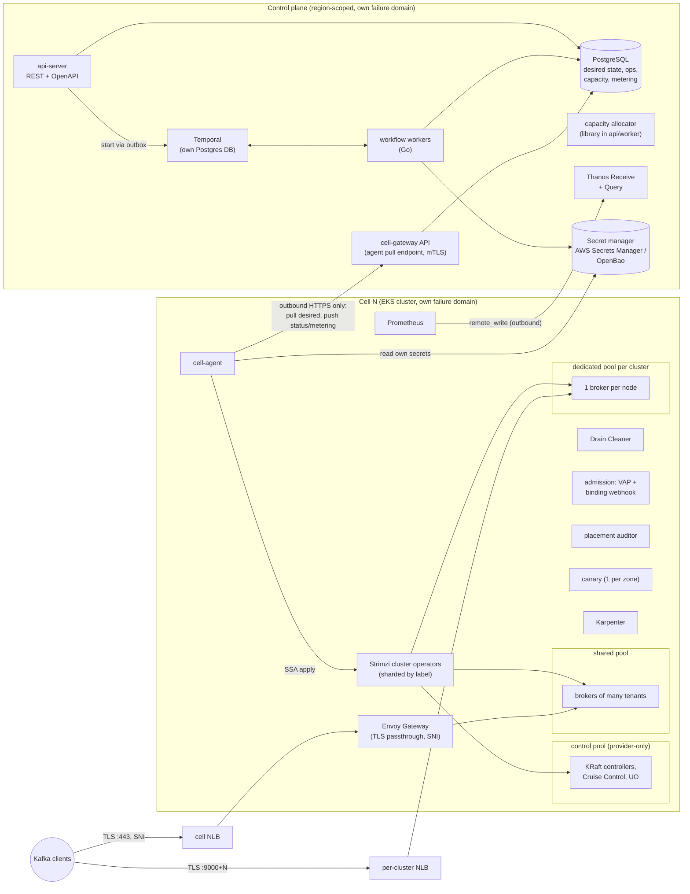
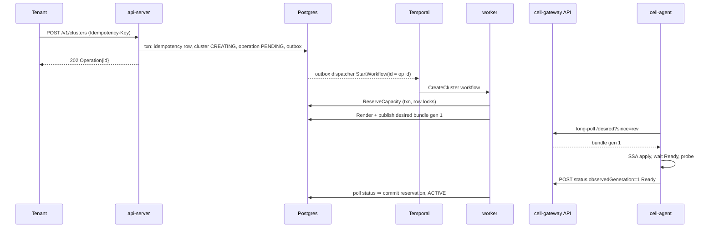
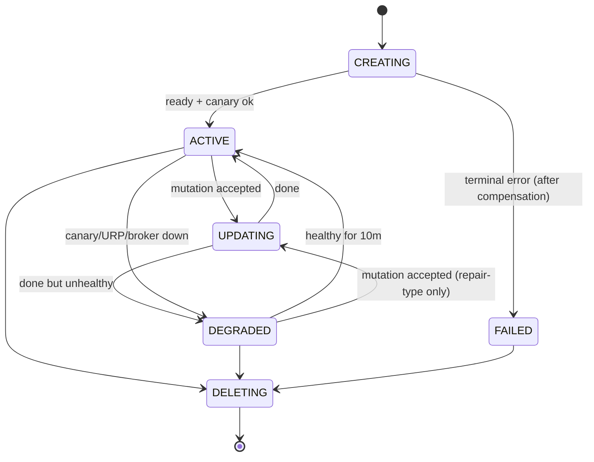
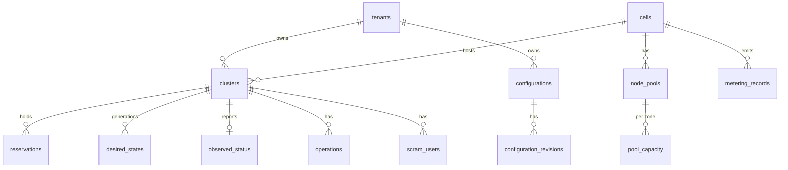

# Streamcell: design (Phase 0)

> **Status:** Phase 0 draft for approval. No implementation code has been written.
> **Date:** 2026-11-04.
> **Working names:** "Streamcell" is a placeholder project name (the brief left `{{PROJECT}}` blank) and `streams.example.net` is a placeholder for `{{DOMAIN}}`. Labels use the prefix `streamcell.dev/`. All three are easy to rename before M1. First cloud: AWS. Licence: Apache-2.0.
> Apache Kafka, Kafka and the Kafka logo are trademarks of the Apache Software Foundation. Streamcell is a platform *for* Apache Kafka and is not affiliated with the ASF.

Contents

1. [Summary](#1-summary)
2. [Upstream check, and changes I propose to the brief](#2-upstream-check-and-changes-i-propose-to-the-brief)
3. [Architecture](#3-architecture)
4. [Control-plane API](#4-control-plane-api)
5. [Data model](#5-data-model)
6. [Workflows](#6-workflows)
7. [Cells and the cell agent](#7-cells-and-the-cell-agent)
8. [Engine interface](#8-engine-interface)
9. [Kafka engine on Strimzi](#9-kafka-engine-on-strimzi)
10. [Placement and capacity](#10-placement-and-capacity)
11. [Tier sizing](#11-tier-sizing)
12. [Noisy-neighbour controls (shared tier)](#12-noisy-neighbour-controls-shared-tier)
13. [Storage safety](#13-storage-safety)
14. [Networking](#14-networking)
15. [Security and threat model](#15-security-and-threat-model)
16. [Lifecycle operations](#16-lifecycle-operations)
17. [Observability, canary and metering](#17-observability-canary-and-metering)
18. [Failure modes](#18-failure-modes)
19. [Testing, milestones and spikes](#19-testing-milestones-and-spikes)
20. [Assumptions and open questions](#20-assumptions-and-open-questions)

ADRs are in [`docs/adr/`](adr/). Dependencies and licences are in [`docs/dependencies.md`](dependencies.md). The detailed version check is in [`docs/upstream-check.md`](upstream-check.md).

---

## 1. Summary

Streamcell gives each tenant a real Apache Kafka cluster with its own brokers, KRaft quorum, namespace, CA, credentials and endpoints. Tenants use stock Kafka clients against stock Apache Kafka brokers. Nothing in the data path parses the Kafka protocol: the shared tier uses TLS passthrough routed by SNI, and the dedicated tier uses L4 load balancers.

Design summary:

- **Control plane** (Go): REST API, PostgreSQL as the source of truth, Temporal for durable workflows, and a capacity allocator that reserves capacity in a transaction before anything is provisioned. The control plane never connects into a cell.
- **Cells**: each cell is one EKS cluster (kind locally) with a size cap. A **cell agent** pulls versioned desired-state bundles over outbound HTTPS, applies them with server-side apply, runs engine probes, and pushes status, inventory and metering records back.
- **Kafka engine**: Strimzi 1.3.x (`kafka.strimzi.io/v1` API only) with `Kafka` and `KafkaNodePool` resources in KRaft mode, Cruise Control via `KafkaRebalance` and auto-rebalance, and Drain Cleaner. The engine sits behind a small `Engine` interface so that the platform core has no Kafka-specific code.
- **Placement** is enforced at four layers: rendered affinity, taints and spread; a `ValidatingAdmissionPolicy` that checks pod specs; a `pods/binding` webhook that checks real node occupancy at bind time; and a continuous auditor, also shipped as a CLI.
- **Shared tier**: Strimzi's `tlsroute` listener (new in Strimzi 1.1) behind one Envoy Gateway per cell, with zone-local routing. **Dedicated tier**: one Karpenter `NodePool` per tenant cluster (one broker per node) and one NLB per cluster with a port per broker.

---

## 2. Upstream check, and changes I propose to the brief

I checked upstream state on 2026-11-04. Only `github.com` and `raw.githubusercontent.com` were reachable from this session, so I verified most facts from upstream source, docs-as-code and release tags, plus web search. `kafka.apache.org`, `strimzi.io`, `aws.amazon.com`, `cwiki.apache.org`, `temporal.io` and `gateway.envoyproxy.io` were blocked; the items that depend on them are marked **re-verify**. Full detail: [`upstream-check.md`](upstream-check.md).

### 2.1 Facts that changed since the brief was written

| Topic | Current state | Effect on design |
|---|---|---|
| Strimzi | 1.3.0 is the latest GA (1.3.1 at RC2, 1.4.0 in development). 1.0 removed every API except `v1`. Requires Kubernetes ≥ 1.32. | Render only `kafka.strimzi.io/v1`. |
| Strimzi `tlsroute` listener | Added in 1.1.0. Generates Gateway API `v1` `TLSRoute`s per broker and for bootstrap. The `ingress` listener type is deprecated. | Shared tier uses `type: tlsroute` instead of hand-built routes on `cluster-ip` services ([ADR-0005](adr/0005-shared-tier-networking.md)). |
| Kafka | 4.4.0 is tagged; 4.3.2 is current on the 4.3 line. Strimzi 1.3 supports 4.2.2 and 4.3.x. Kafka 4.4 needs Strimzi 1.4 (unreleased). ZooKeeper was removed in 4.0. | Launch with 4.3.x, then add 4.4 when Strimzi 1.4 ships. KRaft only. |
| KIP-1066 broker cordoning | Strimzi 1.2 uses it during auto-rebalance on scale-down for Kafka 4.3+. | Scale-in cordons brokers first, so no new replicas land on brokers being drained. |
| Strimzi SA tokens | 1.2 sets `automountServiceAccountToken: false` on the pod spec but mounts a projected token volume instead, into both the rack init container and the broker container (checked in the 1.3.0 source in M2). The default security context matches the Restricted PSS. | A token reaches the brokers; it is limited to `get nodes`. See §10.2 and spike S-4. |
| ingress-nginx | Retired in March 2026 with no further releases. | Not used. Already the brief's position. |
| Bitnami | Free versioned images moved to the unpatched `bitnamilegacy` repo around Aug–Sep 2025. | No Bitnami charts or images. This includes the Postgres and Temporal sub-charts: use CloudNativePG, the official Postgres images, and Temporal with external persistence. |
| Gateway API | v1.5 promoted `TLSRoute` to Standard `v1`; v1.7.0 is the latest tag. Envoy Gateway v1.9.3 vendors gateway-api v1.6.1 and uses `gwapiv1.TLSRoute`. | Envoy Gateway ≥ 1.9 for `TLSRoute v1`. **Re-verify** against the Envoy Gateway compatibility matrix. |
| KIP-1150 diskless topics | Vote passed in March 2026 as a "motivational" KIP. The implementation KIPs (1163, 1164) were still under discussion as of August 2026 (secondary source). | Do not design around it. Already the brief's position. |
| Terraform | Licensed under BSL 1.1. | The brief allows "Terraform or OpenTofu". Only **OpenTofu** (MPL-2.0) meets the licence rule ([ADR-0014](adr/0014-opentofu.md)). |
| Temporal | Server and Go SDK are MIT; v1.32.2 is the latest tag. | Fine. |
| Karpenter | v1.15 has `limits.nodes` and alpha static `replicas` on `NodePool`. | One `NodePool` per dedicated cluster with `limits.nodes = brokers + surge`. |
| Cilium Bandwidth Manager | v1.20 docs: egress limits use EDT shaping; `ingress-bandwidth` uses an eBPF token bucket (policing). | Egress shaping is smooth. Ingress limiting drops packets, so producer traffic is controlled mainly by Kafka quotas ([§12](#12-noisy-neighbour-controls-shared-tier)). |

### 2.2 Things in the brief I would change, or that need a decision

1. **PDB `maxUnavailable: 1` versus Drain Cleaner.** Strimzi's Drain Cleaner docs set `maxUnavailable: 0`. Drain Cleaner then intercepts every eviction, and Strimzi rolls the pod itself, one at a time, only when that does not take a partition below `min.insync.replicas`. With `maxUnavailable: 1`, an eviction that bypasses the webhook (for example, if the webhook is down and its failure policy lets the call through) can remove a broker while another broker is already restarting. **Proposal:** use `maxUnavailable: 0` together with Drain Cleaner. The effective policy is still "at most one broker down", but Strimzi enforces it with ISR awareness. Run Drain Cleaner HA with `failurePolicy: Fail`.
2. **CPU overcommit conflicts with "requests equal limits".** Overcommit means CPU requests are smaller than CPU limits (Burstable QoS). That excludes the CPU-manager static policy, which needs Guaranteed QoS and integer CPUs. **Proposal:** in the shared tier, memory requests equal limits (never overcommitted) and CPU request equals nominal ÷ ratio. Whether a CPU limit is set at all is decided by the M6 benchmark ([ADR-0009](adr/0009-shared-cpu-memory-model.md)). Static policy is benchmarked as an un-overcommitted option.
3. **The partition limit cannot be fully enforced with stock policy plugins.** I read the KRaft controller source (`ReplicationControlManager`, trunk):
   - `CreateTopicPolicy` runs **on the controller**, so the plugin JAR must be in controller images as well as broker images.
   - `CreatePartitions` (adding partitions to an existing topic) **calls no policy**.
   - The policy API gets the request only, not current cluster state.

   **Proposal:** enforce in layers ([ADR-0010](adr/0010-customer-admin-principal-and-plugins.md)):
   - `CreateTopicPolicy` with a cached partition count.
   - A `controller_mutation_rate` quota (KIP-599) to bound bursts.
   - An authorizer wrapper that rejects `CreatePartitions` once the cluster is at its limit.
   - Auditor alerts.

   This keeps the full Kafka API and remains stock plugins, not a fork.
4. **Per-IP connection limits and ACL host matching do not work behind the shared gateway.** Brokers see the Envoy pod IP, and Kafka does not support the PROXY protocol. **Proposal:** enforce connection limits and connection rates in Envoy (Gateway API policy attached to the route), keep per-listener `max.connections` and `max.connection.creation.rate` on brokers, and document that ACL `host` restrictions are not supported in the shared tier.
5. **A ballast *file* is awkward under Strimzi.** Strimzi does not allow custom init containers or sidecars on Kafka pods. **Proposal:** use ext4 reserved blocks as the ballast. `mkfs.ext4` reserves 5 % by default, and only root can use them; Kafka runs as non-root. To recover a full disk, an operator runs `tune2fs -m 0` from a node debug pod ([ADR-0011](adr/0011-storage.md)). Behaviour is the same and nothing extra runs in the pod. Spike S-5 checks that the EBS CSI driver keeps the default.
6. **"A canary per cluster"** is implemented as one canary *service* per cell: three replicas, one per zone, each probing every cluster in the cell through its public endpoint. Each cluster still gets its own canary topic, principal and SLO series. A pod per cluster would add memory overhead to every small shared cluster for no gain in signal.
7. **Controllers for the dedicated tier.** I agree with the brief: put them on the provider's control pool. KRaft controllers are small and latency-sensitive, but they are not on the produce or fetch path. The remaining risk is a noisy *control pool* slowing metadata operations for a dedicated tenant. **Proposal:** controllers run as Guaranteed pods with requests equal to limits, and dedicated clusters use a larger controller size. A "dedicated controller nodes" option can be added later if the M6 measurements show a need.
8. **Per-cluster overhead dominates small shared clusters.** Every cluster needs 3 controllers, the User Operator, Cruise Control and a metrics exporter on the control pool. That is roughly 2–4 vCPU and 8–14 GiB *per cluster* (see [§11](#11-tier-sizing)), comparable to a 3 × `s.small` broker set. This is a pricing decision, not a technical blocker. **Open question Q-7:** offer a dev-only size with smaller controllers and a smaller Cruise Control.
9. **The dedicated tier should not use Strimzi's `loadbalancer` listener**, which creates one NLB per broker. One NLB per cluster with a port per broker costs about a quarter as much at 3 brokers, and the per-GB charges are the same ([§14.4](#144-cost-comparison)).
10. **Data-plane self-sufficiency needs more than "pull".** Storage auto-expansion must keep working while the control plane is down, or a control-plane outage can turn into full disks. The bundle carries pre-authorized bounds (for example `autoExpand.maxSize`), and the agent acts within them locally ([§13](#13-storage-safety)).
11. **Tenant metrics queries cannot go from the control plane into a cell**, because the brief forbids inbound access. Cell Prometheus instances `remote_write` outbound to a central, Apache-licensed TSDB (Thanos Receive). Tenant queries go there, with label enforcement ([§17](#17-observability-canary-and-metering)).
12. **Avoid AGPL observability components as shipped dependencies** (Grafana, Loki, Mimir). They are usable unmodified, but they add obligations for a hosted service. Use Perses (Apache-2.0) for provider dashboards; Grafana stays an optional add-on that operators install themselves ([ADR-0013](adr/0013-observability-stack.md)).

---

## 3. Architecture

### 3.1 Components and failure domains



| Failure domain | What fails | What keeps working |
|---|---|---|
| Control plane (API, Postgres, Temporal, workers) | No creates, changes, deletes or new credentials. The API returns 503. | All running clusters, client traffic, Strimzi self-healing, Drain Cleaner, canary, local metrics and alerts, and local auto-expansion within bounds. Metering spools in the cell. |
| One cell | That cell's clusters. | Other cells, and the control plane. |
| One zone in a cell | ⅓ of the brokers in every cluster. RF 3 / minISR 2 keeps producing with `acks=all`. | Client traffic, with leaders moved to the surviving zones. |
| Central TSDB | Tenant metric queries and long-term graphs. | Cell Prometheus, alerting and the canary. |

### 3.2 Request flow (create)



---

## 4. Control-plane API

REST/JSON with an OpenAPI 3.1 spec as the source; server stubs and the client are generated from it with `oapi-codegen`. Every mutation:

- is asynchronous and returns `202` with an `Operation`;
- requires an `Idempotency-Key` header. The key is scoped to the tenant, and the request body is hashed. The same key with the same body returns the original operation. The same key with a different body returns `422`. Keys are kept for 7 days;
- returns `409 Conflict` if the cluster already has a running mutation (per-resource lock) or is in a state that does not allow the change. This is what MSK does.

### 4.1 Resources

| Method and path | Purpose |
|---|---|
| `POST /v1/clusters` | Create a cluster: `name`, `tier`, `brokerType`, `brokerCount`, `kafkaVersion`, `storage{sizeGiB, maxSizeGiB, autoExpand}`, `configurationArn{id, revision}`, `auth{scram, mtls}`, `connectivity{public, privateLink}`. |
| `GET /v1/clusters`, `GET /v1/clusters/{id}` | List or describe a cluster (state, versions, endpoints, current operation). |
| `DELETE /v1/clusters/{id}` | Delete a cluster. |
| `GET /v1/clusters/{id}/bootstrap-brokers` | Bootstrap strings per auth mechanism. |
| `POST /v1/clusters/{id}/storage` | Expand storage. Shrinking is never allowed. |
| `POST /v1/clusters/{id}/broker-count` | Scale out or in. |
| `POST /v1/clusters/{id}/broker-type` | Change broker size (rolling). |
| `POST /v1/clusters/{id}/configuration` | Apply a configuration revision. |
| `POST /v1/clusters/{id}/version` | Upgrade the Kafka version (staged; see [§16](#16-lifecycle-operations)). |
| `POST /v1/clusters/{id}/version:finalize` | Bump `metadata.version`. Cannot be undone. |
| `POST /v1/clusters/{id}/tier` | Migrate shared → dedicated (spike-gated). |
| `POST/GET/DELETE /v1/clusters/{id}/scram-users[/{name}]` | Manage SCRAM users. The password is generated, or supplied by the tenant, and is stored only in the secret manager. |
| `POST /v1/clusters/{id}/client-certificates` | Submit a CSR and get a client certificate signed by the cluster's clients CA. |
| `GET /v1/clusters/{id}/ca-certificate` | Cluster CA bundle for the truststore. |
| `POST /v1/configurations`, `POST /v1/configurations/{id}/revisions`, `GET …` | Versioned broker configuration objects, validated against the allowlist. |
| `GET /v1/operations/{id}`, `GET /v1/operations?clusterId=` | Operation status. |
| `GET /v1/clusters/{id}/metrics/query` | PromQL over the tenant's own series only (label-enforced). |
| `PUT /v1/clusters/{id}/log-delivery` | Broker log delivery to the tenant's S3 bucket (cross-account role). |
| `GET /v1/kafka-versions`, `GET /v1/broker-types` | Catalogue. |

The provider-only admin API covers cells (`ACTIVE`, `DRAINING`, `SUSPENDED`), pools, tenant pinning, upgrade waves, capacity views and the reservation sweeper. It runs on a separate listener with separate authentication.

**Authentication:** OIDC bearer tokens. Tenant identity comes from a token claim. Every query is scoped by `tenant_id` in the repository layer; there is no unscoped query path for tenant endpoints.

### 4.2 States



`UPDATING` with a failed step returns to `ACTIVE` or `DEGRADED`, depending on health, and the operation records `FAILED` with a reason. A failed update does not leave the *cluster* `FAILED`. `FAILED` is reserved for clusters that never became usable.

Operation states: `PENDING`, `RUNNING`, `SUCCEEDED`, `FAILED`, `CANCELLED`. Each operation carries `type`, `step`, `progress`, `error{code, retryable, message}`.

---

## 5. Data model

PostgreSQL, migrated with `goose`, queried with `sqlc`. Secrets never appear in these tables: only `secret_ref` values (an ARN, or an OpenBao path) are stored.



| Table | Key columns | Notes |
|---|---|---|
| `tenants` | `id`, `name`, `pinned_cell_id NULL`, `limits jsonb` | `limits`: max clusters, max brokers, max storage. |
| `cells` | `id`, `region`, `cloud`, `state` (`ACTIVE`/`DRAINING`/`SUSPENDED`), `limits jsonb`, `operator_shards int`, `last_heartbeat_at`, `revision bigint` | `revision` is the cell's monotonic desired-state revision. |
| `node_pools` | `id`, `cell_id`, `kind` (`control`/`shared`/`dedicated`), `owner_cluster_id NULL`, `instance_type`, `zones text[]`, `max_nodes` | Dedicated pools are 1:1 with clusters. |
| `pool_capacity` | PK (`pool_id`, `zone`); `cpu_m`, `mem_mib`, `ebs_mbps`, `attach_slots`, `nodes` for each of total / allocated / reserved | Locked `FOR UPDATE` in fixed key order. |
| `reservations` | `id`, `operation_id UNIQUE`, `cluster_id`, `status` (`HELD`/`COMMITTED`/`RELEASED`), `demand jsonb`, `expires_at`, `heartbeat_at` | Idempotent because of `operation_id UNIQUE`. |
| `clusters` | `id`, `tenant_id`, `name`, `engine` (`kafka`), `tier`, `cell_id`, `state`, `spec jsonb` (engine-opaque), `spec_generation`, `lock_operation_id NULL`, `deleted_at` | Unique (`tenant_id`, `name`) where not deleted. |
| `desired_states` | PK (`cluster_id`, `generation`); `cell_revision`, `bundle jsonb` (rendered objects), `bundle_digest`, `tombstone bool`, `bounds jsonb` | Append-only. The agent pulls by `cell_revision`. |
| `observed_status` | `cluster_id` PK, `observed_generation`, `conditions jsonb`, `engine_status jsonb`, `endpoints jsonb`, `reported_at` | Written by the cell-gateway API. |
| `operations` | `id`, `tenant_id`, `cluster_id`, `type`, `state`, `step`, `request jsonb`, `error jsonb`, timestamps | |
| `idempotency_keys` | PK (`tenant_id`, `key`); `request_hash`, `operation_id`, `expires_at` | |
| `outbox` | `id`, `kind`, `payload`, `dispatched_at NULL` | The dispatcher starts Temporal workflows with workflow ID = operation ID, so a duplicate dispatch is rejected by Temporal. |
| `configurations`, `configuration_revisions` | `id`, `tenant_id`, `name`; (`configuration_id`, `revision`) PK, `properties jsonb`, `kafka_versions text[]` | Revisions are immutable. |
| `scram_users` | `cluster_id`, `name`, `secret_ref`, `state` | |
| `audit_log` | `id`, `at`, `actor`, `tenant_id`, `action`, `resource`, `request_digest`, `result` | Append-only (enforced by role grants: the app role has no `UPDATE`/`DELETE`). Exported to S3 with object lock. |
| `metering_records` | `record_id` PK (deterministic hash), `cell_id`, `cluster_id`, `meter`, `interval_start`, `interval_end`, `quantity numeric`, `unit`, `received_at` | `INSERT … ON CONFLICT DO NOTHING`. |
| `upgrade_waves` | `id`, `target_version`, `stage`, `cohort` (`internal`/`canary`/`shared`/`dedicated`), `cell_ids` | |

---

## 6. Workflows

Temporal ([ADR-0002](adr/0002-temporal.md)). Workflows are deterministic orchestration code. All side effects are activities, and every activity is idempotent:

| Activity | Idempotency mechanism |
|---|---|
| `ReserveCapacity` | Keyed by `operation_id` (unique). A re-run returns the existing reservation. |
| `EnsureSecret` | Deterministic secret name (`streamcell/<cell>/<cluster>/<purpose>`); create if absent. |
| `PublishDesired` | PK (`cluster_id`, `generation`). Inserting the same digest is a no-op; a different digest for the same generation is a terminal bug. |
| `WaitObserved(gen, cond)` | Read-only poll with heartbeat. |
| `CommitReservation` / `ReleaseReservation` | Status transitions guarded by `WHERE status = 'HELD'`. |
| `SetClusterState` | Compare-and-set on (`state`, `lock_operation_id`). |

**Per-resource lock:** set at the API in the same transaction that creates the operation (`clusters.lock_operation_id IS NULL` → set), and released only by the workflow's final step. The Temporal workflow ID equals the operation ID, so dispatching the same operation twice cannot start two workflows.

**Errors** are typed as `Retryable` (network, throttling, timeouts, a cell not yet reporting) or `Terminal` (validation, capacity exhausted, quota, a bug invariant). Temporal retries only retryable errors, with exponential backoff and a per-activity cap. A terminal error, or running out of retries, triggers **compensation**: the saga runs the recorded undo steps in reverse.

**CreateCluster:** reserve → ensure secrets → render bundle (engine) → publish gen 1 → wait `Ready` (timeout 45 min) → wait canary OK → commit reservation → `ACTIVE` → emit metering start.
Compensation: publish a tombstone → wait for the agent to report it deleted → release the reservation → delete secrets → `FAILED` with a reason.

**Worker killed mid-create (M1 acceptance):** Temporal replays the workflow history. Completed activities are not re-run, and an activity that was in flight is re-run safely because of the table above. The M1 test kills the worker process between every pair of activities and asserts:

- exactly one reservation per operation;
- one desired-state row per generation;
- one set of Kubernetes objects;
- one secret per purpose.

---

## 7. Cells and the cell agent

### 7.1 Cells

A cell is one Kubernetes cluster in one region across 3 zones. Starting limits, to be tuned in M6:

| Limit | Value |
|---|---|
| Tenant Kafka clusters per cell | 200 |
| Nodes per cell | 300 |
| Broker replicas (partitions × RF) per cell | 1,000,000 |
| Clusters per Strimzi operator shard | 50 |

Lifecycle:
- `ACTIVE` accepts new clusters.
- `DRAINING` accepts no new clusters; existing ones keep running and can be updated.
- `SUSPENDED` accepts no mutations except deletes and repairs.

A tenant can be pinned to one cell.

### 7.2 Agent protocol (pull only)

The agent authenticates to the cell-gateway API with a per-cell mTLS identity (an IAM role is an alternative on AWS). It can read only its own cell's desired state.

| Call | Purpose |
|---|---|
| `GET /cell/v1/desired?since={rev}` | Long-poll (30 s). Returns entries `{cluster_id, generation, cell_revision, bundle, bundle_digest, tombstone, bounds}` with `cell_revision > since`. |
| `POST /cell/v1/status` | Batched observed status per resource. |
| `POST /cell/v1/inventory` | Every minute: nodes (zone, instance type, allocatable, CSINode attach count), pools, operator versions, agent version. |
| `POST /cell/v1/metering` | Batched records with deterministic IDs. |
| `POST /cell/v1/heartbeat` | Liveness. The control plane marks the cell `UNREACHABLE` (an observation, not a state change) after 5 minutes without one. |

Safety rules. They are the reason a control-plane outage or bug cannot break running clusters:

1. **Absence never means delete.** Deletion happens only through an explicit tombstone with a higher generation. If the control plane is unreachable, or returns an empty list, the agent keeps the last applied state.
2. **Revisions are monotonic.** The agent persists the last applied `cell_revision` in a ConfigMap. If the control plane serves a lower revision (for example after a database restore), the agent stops applying, raises `CellRevisionRegression`, and waits for a provider to intervene.
3. **Pruning is scoped.** The agent prunes only objects labelled with that cluster's inventory ID that are missing from the *new* bundle of the *same* cluster.
4. **Mass-change brake.** A single poll that would delete more than N clusters' resources, or more than 10 % of the cell, is held for manual confirmation.
5. **Bounds for local autonomy.** A bundle can carry bounds (for example `storage.autoExpand.maxGiB`). The agent can act inside those bounds while the control plane is down and reports what it did afterwards.

Objects are applied with server-side apply (field manager `streamcell-agent`) in dependency order: Namespace → NetworkPolicies → Secrets → NodePool → Kafka/KafkaNodePools → routes and DNS.

---

## 8. Engine interface

The platform core (API, workflows, capacity, agent apply loop) deals only in `ResourceSpec` (common fields plus an opaque engine spec), `PlacementRequest`, `Bundle` and `Status`. Kafka-specific code lives in `engines/kafka`, and ClickHouse will live in `engines/clickhouse`. The interface is sized for exactly these two engines:

```go
// Control-plane side (pure functions; no I/O; deterministic so renders are reproducible).
type Engine interface {
    Name() string                                                     // "kafka"
    Validate(spec ResourceSpec, prior *ResourceSpec) error            // allowlists, transitions (e.g. no storage shrink)
    PlanPlacement(spec ResourceSpec) (PlacementRequest, error)        // pod groups with resources + constraints
    Render(spec ResourceSpec, a Assignment, env CellEnv) (Bundle, error)
    PlanChange(from, to ResourceSpec, a Assignment, env CellEnv) ([]Step, error) // scale, resize, upgrade, config
    PlanDelete(spec ResourceSpec, a Assignment) ([]Step, error)
    ObserveStatus(obs Observed) (Status, error)                       // maps raw CR status + probe results
}

// A Step is: publish this bundle, then wait until this condition holds (evaluated by ObserveStatus).
type Step struct {
    Name    string
    Bundle  Bundle
    WaitFor Condition       // e.g. {Type: "Ready"}, {Type: "Rebalanced"}, {Type: "MetadataVersion", Value: "4.3-IV0"}
    Timeout time.Duration
    Undo    *Step           // compensation, if any
}

// Cell side: engine probes compiled into the agent (read-only).
type Prober interface {
    Probe(ctx context.Context, clusterID string, b Bundle) (ProbeResult, error) // e.g. URP count, offline partitions, partition totals
}

// Generic placement vocabulary — no Kafka words.
type PlacementRequest struct {
    Groups []PodGroup
}
type PodGroup struct {
    Name        string            // "broker", "controller", later "keeper", "shard-0"
    Replicas    int
    Pool        PoolKind          // Shared | Dedicated | Control
    PerPod      Resources         // cpu request/limit, memory, volumes {size, iops, mbps}, attach slots
    Spread      ZoneSpread        // e.g. even across 3 zones, maxSkew 1
    Exclusive   Exclusivity       // None | PerGroupPerNode | WholeNode (dedicated)
}
```

ClickHouse fits this shape: `PodGroup`s for keeper and for each shard's replicas, `PlanChange` steps for resharding, and its own `Prober`. Nothing in the core needs `if engine == "kafka"`. A lint rule (a `depguard` import ban on `engines/*` from `platform/*`) enforces this.

---

## 9. Kafka engine on Strimzi

### 9.1 Per-cluster objects

Namespace `kc-<clusterId>`, containing:

- **`Kafka`** `kc-<id>`: `spec.kafka.version`, `metadataVersion`, listeners (see [§14](#14-networking)), `authorization: {type: custom, authorizerClass: dev.streamcell.kafka.PlatformAuthorizer, superUsers: [platform principals]}`, `rack.topologyKey: topology.kubernetes.io/zone`, `config` (allowlisted customer config + platform defaults), `cruiseControl` with `autoRebalance` for `add-brokers` and `remove-brokers`, and `entityOperator.userOperator` only (no Topic Operator: tenants manage topics through the Kafka API). `template.podDisruptionBudget.maxUnavailable: 0`.
- **`KafkaNodePool` `controllers`**: `roles: [controller]`, 3 replicas, on the control pool, with anti-affinity per cluster on `kubernetes.io/hostname` and a zone spread.
- **`KafkaNodePool` `brokers`**: `roles: [broker]`, with tier-specific placement, shown below.
- **`KafkaUser`** objects for platform principals (canary, exporter) and tenant SCRAM/mTLS users. Passwords come from `spec.authentication.password.valueFrom.secretKeyRef`, and the agent materializes that Secret from the secret manager.
- **NetworkPolicies**, plus a Karpenter `NodePool` and `EC2NodeClass` (dedicated only), plus DNS records.

Platform defaults: `default.replication.factor=3`, `min.insync.replicas=2`, `offsets.topic.replication.factor=3`, `transaction.state.log.replication.factor=3`, `transaction.state.log.min.isr=2`, `replica.selector.class=org.apache.kafka.common.replica.RackAwareReplicaSelector` (follower fetching cuts cross-zone consumer traffic), `auto.create.topics.enable=false`, `create.topic.policy.class.name`, `alter.config.policy.class.name`, and quota and connection limits from [§12](#12-noisy-neighbour-controls-shared-tier).

The image is built `FROM` the Strimzi Kafka image for that Kafka version, plus the Streamcell plugin JAR (policies and authorizer, in Java). This is not a fork: the plugins use public broker extension points. Strimzi's `STRIMZI_KAFKA_IMAGES` maps versions to these images.

### 9.2 Rendered placement (dedicated broker pool, abridged)

```yaml
apiVersion: kafka.strimzi.io/v1
kind: KafkaNodePool
metadata:
  name: brokers
  namespace: kc-7f3a9c
  labels: { strimzi.io/cluster: kc-7f3a9c }
spec:
  replicas: 3
  roles: [broker]
  resources: { requests: { cpu: "7", memory: 27Gi }, limits: { cpu: "7", memory: 27Gi } }
  jvmOptions: { -Xms: 6g, -Xmx: 6g }
  storage: { type: persistent-claim, size: 1000Gi, class: sc-gp3-kc-7f3a9c, deleteClaim: false }
  template:
    pod:
      metadata:
        labels:
          streamcell.dev/role: kafka-broker
          streamcell.dev/cluster: kc-7f3a9c
          streamcell.dev/tier: dedicated
      terminationGracePeriodSeconds: 300
      affinity:
        nodeAffinity:
          requiredDuringSchedulingIgnoredDuringExecution:
            nodeSelectorTerms:
              - matchExpressions:
                  - { key: streamcell.dev/dedicated-owner, operator: In, values: [kc-7f3a9c] }
        podAntiAffinity:
          requiredDuringSchedulingIgnoredDuringExecution:
            - topologyKey: kubernetes.io/hostname
              namespaceSelector: {}                       # all namespaces: no other broker of ANY tenant
              labelSelector: { matchLabels: { streamcell.dev/role: kafka-broker } }
      tolerations:
        - { key: streamcell.dev/dedicated, operator: Equal, value: kc-7f3a9c, effect: NoSchedule }
      topologySpreadConstraints:
        - { maxSkew: 1, topologyKey: topology.kubernetes.io/zone, whenUnsatisfiable: DoNotSchedule,
            labelSelector: { matchLabels: { streamcell.dev/cluster: kc-7f3a9c, streamcell.dev/role: kafka-broker } } }
```

The shared broker pool differs in three ways:
- `nodeAffinity` targets `streamcell.dev/pool=shared`;
- it has no dedicated toleration;
- its anti-affinity `labelSelector` adds `streamcell.dev/cluster: <id>` (no two brokers of *this* cluster on a node), still with `namespaceSelector: {}`, because the label is unique to the cluster.

### 9.3 Operator scaling

Strimzi runs in cluster-wide mode: one watch set, which scales better than per-namespace mode according to Red Hat's tracker. The work is split into **shards** with `STRIMZI_CUSTOM_RESOURCE_SELECTOR=streamcell.dev/operator-shard=<n>`:

- Each shard is a separate Deployment with its own leader-election lease name.
- The engine assigns a shard at create time (least-loaded) and writes the label on the `Kafka` CR. `KafkaRebalance` follows its Kafka CR, per the Strimzi docs.
- Shards also give **operator canary upgrades**: upgrade shard 0 (internal clusters) first, then the rest. CRDs are cluster-scoped, so the CRDs move first, and every running shard must support the installed CRD version. Strimzi's v1-only API makes this simpler.
- Tuning to measure in M6: `STRIMZI_OPERATIONS_THREAD_POOL_SIZE`, `STRIMZI_FULL_RECONCILIATION_INTERVAL_MS`, and reconcile latency per shard size. **There is no published per-operator cluster limit**, so the 50-per-shard figure is a starting guess (spike S-2).

---

## 10. Placement and capacity

### 10.1 Algorithm

```
Allocate(req PlacementRequest, tenant):
  candidates = cells where state = ACTIVE
               ∧ (tenant.pinned_cell = ∅ ∨ cell = tenant.pinned_cell)
               ∧ cell supports engine version
               ∧ cell.limits not exceeded after adding req (clusters, nodes, broker replicas, shard room)
  for cell in candidates ordered by (utilization after placement ASC, cell_id):   -- spread load, bound blast radius
      demand = per (pool, zone): Σ PerPod over replicas assigned to that zone (even split, remainder to zones
               with most headroom)
      feasible if for each (pool, zone):
           free(cpu_req, mem, ebs_mbps, attach_slots) ≥ demand
         ∧ distinct-node feasibility: replicas_in_zone ≤ nodes_available_in_zone   (anti-affinity on hostname)
         ∧ dedicated: pool max_nodes headroom ≥ replicas + surge
      if feasible: return Reserve(cell, demand)
  return Terminal(CAPACITY_EXHAUSTED)

Reserve(cell, demand):                          -- one transaction, READ COMMITTED + row locks
  BEGIN
  SELECT … FROM pool_capacity WHERE (pool_id, zone) IN (…) ORDER BY pool_id, zone FOR UPDATE
  re-check free ≥ demand  (free = total − allocated − Σ active reservations)
  INSERT INTO reservations (operation_id, demand, status='HELD', expires_at=now()+20m) ON CONFLICT (operation_id) DO NOTHING
  UPDATE pool_capacity SET reserved = reserved + demand …
  COMMIT
```

- Locks are taken in a fixed `(pool_id, zone)` order, so concurrent creates cannot deadlock. The re-check under the lock means they cannot oversubscribe. The M2 test runs 50 concurrent creates against a pool sized for 10 and asserts exactly 10 succeed.
- The workflow heartbeats `reservations.heartbeat_at` and extends `expires_at` while provisioning runs. A **sweeper** releases `HELD` reservations past `expires_at` whose operation is not `RUNNING`.
- `total` comes from agent inventory. For an autoscaled shared pool, it is the pool's configured maximum nodes × per-node allocatable. `allocated` is committed reservations. This is reconciled against observed pod requests, and drift raises an alert.
- **Dimensions tracked:**
  - CPU requests and memory;
  - **instance EBS bandwidth** (the sum of provisioned volume throughput on a node must fit the instance's *baseline* EBS throughput; per-volume provisioning alone does not isolate this);
  - volume attachment slots (from `CSINode.spec.drivers[].allocatable.count`);
  - nodes per zone;
  - partitions (a per-cluster limit derived from size, and a per-cell total).
- The control plane does not pick individual nodes; the scheduler does. The control plane guarantees feasibility, and admission plus the auditor guarantee the invariants.

### 10.2 Enforcement layers (as built in M2; each row has a test, see `docs/milestones/m2.md`)

Placement is expressed with engine-neutral labels (`internal/platform/labels`) that every engine puts on the pods it renders: `streamcell.dev/cluster`, `role`, `required-pool` (`shared` | `dedicated` | `control`) and `exclusive` (`per-resource` | `whole-node`). The policy, the guard and the auditor know nothing about Kafka. The rule logic itself lives once, in `internal/placement`, and is shared by the guard and the auditor.

| # | Invariant | Rendered by the engine | Refused at admission by | Detected by the audit as |
|---|---|---|---|---|
| 1 | No two brokers of one cluster on a node (both tiers) | Required pod anti-affinity on `kubernetes.io/hostname`, `namespaceSelector: {}`, selecting the cluster's own pods of that role | Policy `[anti-affinity]` (term must be present and exactly right). Guard: refuses a bind when the node already hosts a pod of the same cluster and role | `same_group_on_node` |
| 2 | Zone spread | `topologySpreadConstraints` over the zone label, maxSkew 1, `DoNotSchedule` | Policy `[zone-spread]` | `zone_skew` (pods per candidate zone differ by more than 1). **`broker.rack` vs the node's zone is not audited yet:** it needs a Kafka connection (M3 probes) |
| 3a | Dedicated: own pool, own taint | One node pool per cluster: nodes labelled `dedicated-owner=<id>`, tainted `streamcell.dev/dedicated=<id>:NoSchedule`; pods require the owner label and tolerate only that taint | Policy `[pool]`, `[tolerations]` (wildcard, other clusters' taints and `Exists` on the dedicated key are all refused). Node protection policy: only the provisioner may change pool labels and taints | `dedicated_node_foreign_pod` |
| 3b | Dedicated: exactly one broker per node, against all brokers of all tenants | Anti-affinity selecting every pod of the role, in every namespace | Policy `[anti-affinity]`. Guard: refuses a bind onto a node that already has a whole-node pod | `dedicated_node_multi_exclusive` |
| 3c | Node count = broker count (+ surge) | Capacity reserves exactly one node per broker; the provider claims exactly that many (Karpenter: `limits.nodes = brokers + surge`) | n/a | `dedicated_node_count_mismatch` (a resource holds more nodes than pods + surge). The "max 2 h surge" timer is not implemented; the alert waits 30 minutes instead |
| 4 | Shared pods stay in the shared pool; control pods in the control pool | Pool node affinity; dedicated and control taints | Policy `[pool]`, `[tolerations]`. Guard: refuses binds to a node of the wrong pool | `pod_off_pool` |
| 5 | Admission as defence in depth | `ValidatingAdmissionPolicy` (CEL, sees the pod) + `pods/binding` guard (sees the node), scoped to tenant namespaces, `failurePolicy: Fail`, 2+ replicas with a PDB | (this row) | (see 6) |
| 6 | Continuous audit | `placement-auditor` Deployment and the `streamcell-audit` CLI, same code | n/a | `streamcell_placement_violations{rule,cluster,node}`; alerts with runbooks, plus an alert if the auditor itself goes silent |

The admission policy additionally refuses: pods without placement labels, a `cluster` label that differs from the namespace, `spec.nodeName` set at creation (it would bypass the scheduler and the guard), changes to placement labels after creation, `hostNetwork`/`hostPID`/`hostIPC`, `hostPath` volumes, privileged containers and `hostPort`.

Controllers get the same per-cluster hostname anti-affinity and zone spread on the control pool (taint `streamcell.dev/control:NoSchedule`).

**Security-context rules are not in the policy yet.** The earlier draft listed `automountServiceAccountToken: false`, `runAsNonRoot` and `seccompProfile` as policy rules. Spike S-4 (below) showed Strimzi 1.3 mounts a service-account token into the broker container, so that rule cannot hold for Strimzi pods. The kind smoke test now prints the real security context of a broker pod; `runAsNonRoot`/seccomp/`readOnlyRootFilesystem` rules are added in M3 once that evidence is reviewed.

**Known weaknesses of the guard** (also in `docs/milestones/m2.md`):
- Decisions are serialised per node *within one replica*. With 2+ replicas two simultaneous binds to the same node could both be admitted. The scheduler binds one pod at a time and enforces the same anti-affinity, so this needs a scheduler bug *and* a race; the auditor catches it.
- Its serving certificate is valid for 10 years and is not rotated. An expired certificate with `failurePolicy: Fail` stops all binds in tenant namespaces. cert-manager integration and an expiry alert are M6 items.
- Node labels set when a node *registers* itself (Karpenter-launched nodes) are trusted; the node protection policy covers only later changes.

---

## 11. Tier sizing

The numbers below are **starting values**. Heap, page cache and CPU are validated by the M6 benchmarks. Instance figures are for AWS and must be checked against current EC2 docs (**re-verify**).

### 11.1 Shared broker sizes (node type: 16 vCPU / 64 GiB general purpose, e.g. m7i.4xlarge or m8g.4xlarge)

Node allocatable after kube/system reservation and DaemonSets is about 15 vCPU and 57 GiB. CPU overcommit ratio: 2.0 (configurable per pool).

| Size | CPU nominal (limit) / request | Memory (req = limit) | Heap | Page cache + off-heap | Storage | Volume IOPS / MB/s | Pod egress limit | Max partition replicas per broker | Fits per node (memory-bound) |
|---|---|---|---|---|---|---|---|---|---|
| `s.small` | 2 / 1 | 6 GiB | 2 GiB | ~3.5 GiB | 10 GiB – 2 TiB | 3,000 / 125 | 250 Mbit/s | 300 | 9 |
| `s.medium` | 4 / 2 | 12 GiB | 4 GiB | ~7.5 GiB | 10 GiB – 4 TiB | 4,000 / 250 | 500 Mbit/s | 1,000 | 4 |
| `s.large` | 8 / 4 | 24 GiB | 6 GiB | ~17 GiB | 10 GiB – 8 TiB | 6,000 / 500 | 1 Gbit/s | 2,000 | 2 |

Node packing is also bounded by the instance's baseline EBS throughput and network bandwidth. The allocator tracks both ([§10.1](#101-algorithm)).

### 11.2 Dedicated broker sizes (one broker pod per node; the pod gets the whole node minus reservation)

| Size | Instance (example) | Pod CPU / memory | Heap | Storage | Max partition replicas per broker |
|---|---|---|---|---|---|
| `d.xlarge` | m7i.xlarge (4 / 16) | 3.2 / 12.5 GiB | 4 GiB | gp3, up to 16 TiB | 2,000 |
| `d.2xlarge` | m7i.2xlarge (8 / 32) | 7 / 27 GiB | 6 GiB | gp3, up to 16 TiB | 3,000 |
| `d.4xlarge` | m7i.4xlarge (16 / 64) | 15 / 58 GiB | 8 GiB | gp3, up to 16 TiB | 4,000 |
| `d.8xlarge` | m7i.8xlarge (32 / 128) | 31 / 120 GiB | 10 GiB | gp3, up to 16 TiB | 6,000 |
| `d.nvme.2xlarge` | i4i.2xlarge (8 / 64, 1 × 1.875 TB NVMe) | 7 / 58 GiB | 6 GiB | local NVMe, fixed | 3,000 |
| `d.nvme.4xlarge` | i4i.4xlarge (16 / 128, 1 × 3.75 TB NVMe) | 15 / 120 GiB | 8 GiB | local NVMe, fixed | 4,000 |

Dedicated pods are Guaranteed with integer CPUs, so the CPU-manager static policy is an option and the M6 benchmark decides. NVMe sizes cannot expand storage; growth means scaling out.

### 11.3 Per-cluster control-pool footprint

| Pod | Count | CPU req/limit | Memory | Notes |
|---|---|---|---|---|
| KRaft controller `c.small` (shared tier) | 3 | 0.5 / 1 | 2 GiB (heap 1 GiB) | 20 GiB gp3 |
| KRaft controller `c.standard` (dedicated tier) | 3 | 1 / 1 | 4 GiB (heap 2 GiB) | Guaranteed |
| Cruise Control | 1 | 0.25 / 1 | 1.5 GiB | Always on: enabling it later would roll every broker to add the metrics reporter |
| User Operator (Entity Operator) | 1 | 0.1 / 0.5 | 384 MiB | Topic Operator disabled |
| Kafka Exporter (consumer lag) | 1 | 0.05 / 0.2 | 128 MiB | |
| **Total for a shared cluster** | | **≈ 1.9 vCPU requested** | **≈ 8 GiB** | Compare with 3 × `s.small` = 3 vCPU requested, 18 GiB. See open question Q-7. |

---

## 12. Noisy-neighbour controls (shared tier)

| Layer | Control | Notes and residual risk |
|---|---|---|
| Memory | Requests equal limits, never overcommitted. The heap is fixed with `-Xms = -Xmx`, sized as in [§11](#11-tier-sizing). The rest of the limit is for page cache and off-heap (network buffers, TLS, metaspace). | Under cgroup v2, page cache counts against the pod's `memory.max`. A neighbour therefore cannot evict our cache except through node-level pressure, and node pressure is ruled out because memory is not overcommitted. Watch `container_memory_working_set_bytes` against the limit to catch OOM risk from off-heap growth. |
| CPU | Request = nominal ÷ 2.0, which gives `cpu.weight` proportional share under contention. M6 benchmark matrix: (a) request with limit = nominal (CFS quota), (b) request only, no limit, (c) static CPU manager with Guaranteed integer CPUs and no overcommit. Measure p99/p999 produce latency with an aggressive neighbour. | TLS is always on, which costs CPU: Kafka cannot use `sendfile` zero-copy under TLS. CFS throttling at the quota boundary is the known tail-latency risk in (a). The default picked after M6 is recorded in ADR-0009. |
| Disk | One gp3 volume per broker with provisioned IOPS and throughput, changed online through `VolumeAttributesClass`. No local disks in the shared tier. | The node's EBS bandwidth is shared across volumes, so the allocator caps the sum of provisioned throughput at the instance's baseline EBS bandwidth. |
| Network | Cilium Bandwidth Manager: `kubernetes.io/egress-bandwidth` per size (EDT shaping, smooth). `ingress-bandwidth` is set as a backstop at 1.5 × nominal: it uses token-bucket policing, which drops packets, so it is not the primary control. | Broker egress covers consumer fetches *and* outgoing replication, so the limit is sized with that in mind. Producer inbound traffic is shaped mainly by Kafka produce quotas (the broker delays responses rather than dropping packets). |
| Kafka quotas | `<default>` user quotas per broker, set through the Admin API by the agent at cluster create: `producer_byte_rate`, `consumer_byte_rate`, `request_percentage`, and `controller_mutation_rate` (KIP-599, which limits partition create and delete rate). Per-user overrides come through the API. | Quotas are per broker. Cluster quota = per-broker quota × brokers. |
| Connections | Broker: `listener.name.<l>.max.connections`, `max.connection.creation.rate` (KIP-612). Gateway: per-route connection limit and new-connection rate in Envoy. | `max.connections.per.ip` is not meaningful behind the gateway (see [§2.2](#22-things-in-the-brief-i-would-change-or-that-need-a-decision), item 4). |
| Metadata pressure | Partition-replica limit per broker by size ([§11](#11-tier-sizing)), enforced in layers: `CreateTopicPolicy` (on controllers, with the count cached ≤ 15 s), `controller_mutation_rate` to bound bursts inside the cache window, `PlatformAuthorizer` rejecting `CreatePartitions` while at or over the limit, and an auditor alert. `AlterConfigPolicy` enforces the topic-config allowlist and floors (e.g. `min.insync.replicas ≥ 2` when RF ≥ 3). | `CreatePartitions` can overshoot by at most one request's worth when it races the cache. That is bounded and alerted. |
| Controllers | Controllers of different tenants share the control pool. They are Guaranteed and spread so that no two controllers of one cluster share a node. | A controller-heavy tenant (a partition storm) is bounded by `controller_mutation_rate`. |

---

## 13. Storage safety

- **Alerts** at 75 % (warning) and 85 % (critical) used, from `kubelet_volume_stats_*` per PVC. Both go to the provider and the tenant.
- **Auto-expand** is run by the agent inside the bundle's bounds: at 80 % used, grow by `max(25 %, 100 GiB)`, up to `maxSizeGiB`. It works by patching the `KafkaNodePool` storage size, after which Strimzi resizes the PVCs and ext4 grows online.
  - EBS allows one modification per volume per 6 hours (**re-verify**). The agent records `lastModified`, does not retry inside the cooldown, and makes each step large enough to last.
  - The agent reports the new size, and the control plane adopts it as the floor of the desired spec, so a later render never shrinks it.
  - The workflow path (tenant-initiated expansion) uses the same mechanism.
- **Full disk:** a broker with a full single log dir takes the log dir offline and stops. Ballast = ext4 reserved blocks (5 %, usable only by root; Kafka runs as UID 1001). Runbook `RB-disk-full`:
  1. Confirm the alert and which brokers are affected.
  2. Release the reserve with `tune2fs -m 0` on the device, using a privileged node-debug pod run by the provider.
  3. The broker restarts and recovers.
  4. Expand the volume, or work with the tenant on retention.
  5. Restore with `tune2fs -m 5`.

  Strimzi's restarts are unaffected. No automatic data deletion happens unless the tenant opts in to "retention guard".
- **Tiered storage (v2):** evaluate KIP-405 (GA since Kafka 3.9) with Aiven's `tiered-storage-for-apache-kafka` plugin (Apache-2.0, S3/GCS/Azure) as an optional feature. Design hooks only: a per-cluster IAM role and bucket prefix, and an egress NetworkPolicy to S3 endpoints.
- **Diskless topics (KIP-1150):** accepted as a motivational KIP; the implementation KIPs are unfinished. Not in scope.
- **Local NVMe (dedicated):** TopoLVM or the local static provisioner (spike S-8). Data is lost with the node, so rotation and replacement always re-replicate first ([§16](#16-lifecycle-operations)).

---

## 14. Networking

### 14.1 DNS

- Bootstrap: `bootstrap.<clusterId>.<cell>.streams.example.net`
- Brokers: `b<N>.<clusterId>.<cell>.streams.example.net`, where N is the Strimzi node ID.

The agent manages the records in the cell's Route 53 hosted zone (it has IAM rights to that zone only). Using node IDs means names stay stable through rolls. A scale-out adds new names.

### 14.2 Shared tier: Strimzi `tlsroute` with Envoy Gateway, zone-local

- One Envoy Gateway `Gateway` per cell with a `TLS` listener on 443 in `Passthrough` mode. Each Kafka CR has an external listener `{type: tlsroute, port: 9094, tls: true, configuration: {bootstrap.host, hostTemplate: "b{nodeId}.<id>.<cell>.streams.example.net", parentRefs: [cell gateway]}}`. Strimzi creates the per-broker ClusterIP Services and `TLSRoute`s.
- Envoy reads only the SNI in the TLS ClientHello and forwards bytes. It is not a protocol proxy. The broker terminates TLS with the per-cluster certificate, which includes these SANs.
- **Zone-local path:** one NLB per cell with cross-zone load balancing **off**, and Envoy pods in every zone as IP targets.
  - Per-broker DNS records are CNAMEs to the NLB's **zonal** DNS name for the broker's zone. The broker's zone is fixed by its EBS volume.
  - Envoy then routes to the broker Service, which has a single local endpoint.
  - Result: client → NLB(zone z) → Envoy(z) → broker(z), with no extra cross-zone hop added by the platform.
  - Bootstrap uses the regional NLB name.
  - If the Envoy pods in a zone fail, a Route 53 health check fails the zonal names over to the regional name.
- Per-route connection limits through Envoy Gateway policy (spike S-3 checks that policy attachment works for `TLSRoute`).

### 14.3 Dedicated tier

Strimzi `cluster-ip` listener plus a platform-managed NLB per cluster with **one listener port per broker**. Port 9000 is bootstrap (to all brokers) and port 9001+N goes to broker N, using IP targets on the broker pod. `advertisedHost` is set to `b<N>.<id>…` and `advertisedPort` to 9001+N per broker. NLB listener quota: 50 per load balancer, so this design supports up to 49 brokers.

Private connectivity: the same NLB, internal, fronted by a **VPC endpoint service** (PrivateLink). Customers create interface endpoints, and the per-broker ports work unchanged. DNS for the customer side uses the endpoint service's private DNS name (verified domain) or a customer private hosted zone. Spike S-9 checks the wildcard and per-broker name handling. MSK's multi-VPC connectivity is the public prior art.

### 14.4 Cost comparison

AWS us-east-1 list prices from my reference knowledge, **not fetched today; re-verify**:
- NLB $0.0225/h plus $0.006 per NLCU-hour. For TCP traffic, 1 NLCU covers 1 GB/h processed, so data costs about $0.006/GB.
- Public IPv4 $0.005/h per address (3 per internet-facing NLB).
- PrivateLink endpoint $0.01/h per AZ plus $0.01/GB.
- Cross-AZ $0.01/GB in each direction.

Monthly cost for 730 hours. "T" is total client traffic (produce plus consume) through the load balancer.

| Option | Fixed, 3 brokers | Fixed, 6 brokers | Per-GB data | At T = 10 MB/s (26.3 TB/mo) | Isolation | Notes |
|---|---|---|---|---|---|---|
| A. Strimzi `loadbalancer`: NLB per broker + bootstrap | 4 × ($16.43 + $10.95) = **$109.5** | 7 × $27.38 = **$191.7** | $0.006 | + $158 | Full | Fixed cost grows linearly with brokers. |
| **B. One NLB per cluster, port per broker** (chosen) | **$27.4** | **$27.4** | $0.006 | + $158 | Full | ≤ 49 brokers. Needs per-broker port config. |
| C. Shared cell gateway (as in the shared tier) | ~$27.4 + Envoy pods ÷ tenants | same | $0.006 + Envoy CPU | + $158 | Shared data-path component | Breaks the "no neighbour" goal of the dedicated tier. Shared tier only. |
| D. B + PrivateLink (customer side) | NLB $16.43 (internal) + endpoints 3 × $7.30 = $21.90, paid by customer | same | $0.006 + $0.01 | + $421 | Full | Private connectivity. |
| E. VPC peering to routable pod IPs | $0 | $0 | $0 same-AZ, $0.01 cross-AZ | ≈ $0–$175 | Network-level only | Cheapest per GB, but needs CIDR planning, puts many tenants in one cell VPC, and relies entirely on NetworkPolicy. Not proposed for v1. |

Conclusion: above about 1 MB/s, the **per-GB** charge dominates, and it is the same in A–C. The fixed cost is the difference: B saves about $27 per broker per month compared with A. At high throughput, D's extra $0.01/GB matters, and that is a pricing input. Replication traffic (RF 3) crosses zones at $0.02/GB of produced data and is a provider cost in every option. Follower fetching (`client.rack`) cuts consumer cross-zone traffic.

---

## 15. Security and threat model

### 15.1 Controls

- **TLS everywhere.** Every listener has TLS. Each cluster has its own cluster CA and clients CA (Strimzi-managed, per `Kafka` CR). By default the tenant downloads the cluster CA (`GET /ca-certificate`). Optionally, external listener certificates come from a public ACME CA via `brokerCertChainAndKey` (Q-3: per-domain issuance rate limits apply).
- **Authentication:** SCRAM-SHA-512 and mTLS (`type: tls` on a separate listener port, or one listener with both; Q-4).
- **Authorization:** Kafka ACLs through `PlatformAuthorizer`, a wrapper around `StandardAuthorizer` ([ADR-0010](adr/0010-customer-admin-principal-and-plugins.md)).
- **Customer admin principal:** each cluster's `admin` user.

| Allowed | Denied |
|---|---|
| Full topic, group and transactional-ID operations, ACL create/describe/delete, `DescribeConfigs`, `AlterConfigs`/`IncrementalAlterConfigs` on topics (allowlist enforced by `AlterConfigPolicy`), `DescribeCluster`, quotas describe, `DeleteRecords` (**not** `ElectLeaders`: it needs cluster `Alter`, which tenants hold for `CreateAcls`/`DeleteAcls` only; see ADR-0010) | Broker or cluster `AlterConfigs`; `AlterPartitionReassignments`; `AlterUserScramCredentials` (users are managed through the API, so the secret manager stays authoritative); `UnregisterBroker`; `AlterClientQuotas` (through the API); `CreateAcls` that names platform principals, reserved resources (`__*`, `strimzi.*`), cluster-level resources, or host restrictions; `DeleteAcls` filters that do not name topic, group or transactionalId; cluster-wide `Create` (it bypasses per-topic checks); any operation on reserved names |

- **Super users:** platform principals only (UO, CC, canary, agent probe), each with a separate credential. Tenants never get super-user rights, and never get any Kubernetes access.
- **Configuration allowlist:** customers may set retention, segment, compression, message size limits within bounds, `num.partitions` and similar. Rejected: `listener*`, `advertised*`, `ssl.*`, `sasl.*`, `*.class*`, `*.jaas*`, `authorizer*`, `super.users`, `security.*`, `principal.builder*`, `log.dirs`, `broker.*`, `controller.*`, `metadata.*`, `remote.log.*`, `*.policy.*`, quota callbacks, `zookeeper.*`. The list is explicit and kept per version; anything unknown is rejected.
- **Isolation:**
  - Default-deny `NetworkPolicy` in every tenant namespace, in both directions. Allowed: intra-cluster replication and controller traffic; the gateway namespace to the external listener; the canary, agent probe, Prometheus and Cruise Control to specific ports; DNS.
  - A Cilium cluster-wide policy denies `169.254.169.254/32`, `fd00:ec2::254`, and the EKS Pod Identity endpoint from tenant namespaces. IMDSv2 hop limit is 1 on nodes.
  - Brokers carry a service-account token that can only `get nodes` (spike S-4: Strimzi mounts it into the broker container for rack awareness and it cannot be removed without forking). Mitigation: the ClusterRole grants nothing else; a compromised broker can read node names, labels and addresses. `runAsNonRoot`, `seccomp: RuntimeDefault`, all capabilities dropped, and `readOnlyRootFilesystem` where Strimzi allows it (spike S-4).
- **Encryption at rest:** EBS encrypted with a KMS key per cell. Optionally, dedicated clusters can use a customer-managed key through a per-cluster StorageClass (`kmsKeyId`). NVMe instance-store encryption is hardware-level on Nitro (**re-verify** for the chosen instance families).
- **Audit:** every control-plane mutation is written to `audit_log` in the same transaction as the change. EKS audit logs are kept per cell.
- **Supply chain:** images are signed with cosign and come with SBOMs. A cell-level admission policy admits only signed images from the provider registry.

### 15.2 Threat model (STRIDE, abridged)

| Threat | Example | Mitigation | Residual |
|---|---|---|---|
| Spoofing | A tenant sends tenant B's SNI | Reaches B's broker TLS, but authentication needs B's credentials or a certificate from B's clients CA (per-cluster CA) | Same exposure as any public endpoint. Rate-limited at Envoy. |
| Spoofing | A stolen cell agent identity | The identity is scoped to one cell. The agent can read only its own desired state and can write only status and metering for its own clusters | That cell's metering could be falsified. The control plane reconciles against observed inventory and flags anomalies. |
| Tampering | A tenant sets `listener.*` or plugin configs | Allowlist at the API, `AlterConfigPolicy` on brokers, and the authorizer denies broker `AlterConfigs` | — |
| Tampering | A control-plane bug or database restore issues mass deletes | Absence ≠ delete, monotonic revision check, mass-change brake ([§7.2](#72-agent-protocol-pull-only)) | — |
| Repudiation | A disputed delete | Append-only audit log with the request digest and actor | — |
| Info disclosure | A cross-tenant network path | Default-deny NetworkPolicy, separate namespaces, block on cloud metadata | — |
| Info disclosure | A broker RCE escapes the container onto a shared node | Non-root and seccomp (to be verified, see S-4), a token that can only `get nodes`, no host mounts, cluster-wide kernel patching cadence | **A kernel escape on a shared node exposes co-located tenants.** The dedicated tier removes this. A gVisor or Kata evaluation is listed as a v2 item. |
| Info disclosure | Metrics or logs leak across tenants | Label enforcement on queries, log delivery per namespace | — |
| DoS | A noisy neighbour | [§12](#12-noisy-neighbour-controls-shared-tier) controls. The SLO is set from M6 measurements | Bounded, not eliminated |
| DoS | A partition storm or connection flood | `controller_mutation_rate`, partition limits, connection limits at Envoy and on brokers | — |
| Elevation | A customer admin grants itself cluster rights | `PlatformAuthorizer` filters `CreateAcls` | — |
| Elevation | A tenant pod schedules onto a dedicated or control node | Taints, VAP (no foreign tolerations), binding webhook | — |

---

## 16. Lifecycle operations

Every operation is a list of `Step`s from `Engine.PlanChange`. The M4 acceptance test runs each one under continuous `acks=all`, `enable.idempotence=true` load. A verifier consumes everything and checks that every acknowledged `(producerId, sequence)` and payload hash is present, then reports lost and duplicated messages.

| Operation | Steps (Kafka engine) | Safety |
|---|---|---|
| Storage expand | Patch the node pool storage size → wait until PVCs are resized | No shrink. EBS cooldown respected. |
| Scale out | Reserve capacity → (dedicated: raise NodePool `limits.nodes`) → raise `KafkaNodePool.replicas` → Strimzi `autoRebalance add-brokers` → wait `Rebalanced`, URP = 0 | Strimzi creates the brokers. Cruise Control moves partitions. |
| Scale in | Pre-check: projected disk use on the remaining brokers ≤ 75 % and partition replicas ≤ limit, otherwise a terminal refusal → lower replicas (Strimzi `remove-brokers` auto-rebalance with KIP-1066 cordoning) → wait until the brokers are empty and removed → lower the dedicated pool → release capacity | Strimzi itself refuses to remove brokers that still hold partitions. |
| Size change | Shared: change resources and heap in the pool → Strimzi rolling restart, one broker at a time, each waiting until no partition would drop below minISR. Dedicated: new NodePool requirements (instance type) → Karpenter surge node → broker moved by drain (EBS) or by re-replication (NVMe, see node rotation) | One broker at a time. URP = 0 between brokers (probe gate). |
| Config change | Validate the revision → render → Strimzi applies dynamic configs without a roll, or rolls for static ones | |
| Version upgrade | (1) Set `spec.kafka.version`, keep `metadataVersion` → Strimzi rolling restart (controllers first) → soak 24 h (canary SLO and error-rate gates) → (2) the tenant or provider finalizes `metadataVersion`. Rollback before (2) by setting the version back. | Waves: internal → opt-in canary tenants → shared → dedicated, cell by cell. |
| Operator upgrade | CRDs → shard 0 (internal) → remaining shards | Shards give the canary. |
| Tier migration (shared → dedicated) | Add pool `brokers-d` (dedicated placement), add dedicated NLB listener exposure → `remove-brokers` rebalance off the shared pool → delete the shared pool → repoint the bootstrap DNS name | **Spike S-6** decides feasibility. Risk: Strimzi listeners are cluster-wide, not per pool, so mixed exposure during migration needs two listeners and a roll. Fallback: a new cluster plus MirrorMaker 2-based migration run by the tenant, with a new bootstrap. |
| Node rotation (EBS) | Karpenter drift → evictions → Drain Cleaner turns them into Strimzi rolls → the pod restarts on a new node in the same zone and reattaches its volume | PDB 0 + Drain Cleaner. NodePool `disruption.budgets: nodes: "1"`. Karpenter `terminationGracePeriod` long enough (12 h) never to cut a roll short. |
| Node rotation (NVMe) | `do-not-disrupt` on brokers. The Streamcell rotation controller: add a surge broker (new node) → `remove-brokers` for the old ID → wait until it is empty and URP = 0 → remove the old ID (`strimzi.io/remove-node-ids`) → delete the node | Never removes a node holding the last in-sync copy: it re-checks ISR for every partition on that broker before deleting. |

---

## 17. Observability, canary and metering

- **Metrics:** Strimzi metrics reporter / JMX exporter on brokers and controllers, Cruise Control metrics, Kafka Exporter for consumer lag, kube-state-metrics and node-exporter. Per-cell Prometheus (with Alertmanager for cell-local alerts) `remote_write`s to central Thanos Receive. Tenant queries go through `prom-label-proxy`, which enforces `cluster_id`, and only a curated set of metric names is exposed.
- **Logs:** a Fluent Bit DaemonSet tails broker and controller containers in `kc-*` namespaces and writes to the provider S3 bucket under `tenant/<t>/cluster/<c>/`. Optional delivery to the tenant's bucket through an assumed cross-account role. The API serves recent logs through presigned URLs.
- **Canary:** a per-cell Deployment with 3 replicas, one per zone. For each ACTIVE cluster it produces with `acks=all` to `__platform_canary` (partitions = brokers, one leader per broker) every 2 s through the **public** endpoint, then consumes and measures end-to-end latency per broker. SLIs: availability (successful round trips ÷ attempts) and p99 latency. `DEGRADED` is set when availability is below 99 % over 5 minutes, or when under-min-ISR partitions > 0 for 2 minutes, or when a broker has been down for more than 5 minutes. M5 test: inject a NetworkPolicy blackhole or kill the leader broker, and assert that `DEGRADED` is set within 5 minutes and cleared after recovery.
- **Provider alerts:** every alert carries a `runbook_url` annotation pointing to `docs/runbooks/<alert>.md`. The CI lint fails if the runbook is missing. Dashboards are Perses.
- **Metering:** the agent samples every minute and closes hourly intervals. Records:

  | Meter | Unit | Source |
  |---|---|---|
  | `broker_hours{size}` | hours | Running broker pods |
  | `storage_gb_hours` | GB-hours | Provisioned PVC size |
  | `data_in_bytes`, `data_out_bytes` | bytes | Kafka `BytesInPerSec`/`BytesOutPerSec`, client-facing only, replication excluded |
  | `privatelink_bytes` | bytes | NLB metrics |

  `record_id = sha256(cell, cluster, meter, labels, interval_start, interval_end, schema_version)`. Records are spooled in the agent's PVC (WAL) until acknowledged, and inserted with `ON CONFLICT DO NOTHING`. If a later record has the same ID but a different quantity, that is flagged as a conflict and never overwritten; corrections are separate adjustment records. M5 test: inject duplicate deliveries, agent restarts and control-plane outages, then assert that totals equal the ground truth computed from the test's own pod and PVC timeline.

---

## 18. Failure modes

| Failure | Detection | Effect | Response |
|---|---|---|---|
| Control plane down | Health checks; agents' heartbeats fail | No mutations | Data plane continues ([§3.1](#31-components-and-failure-domains)). Agents back off and keep their last state. Metering spools. |
| Postgres primary loss | CNPG / RDS failover | Seconds to minutes of 503 | Workflows retry. Idempotency prevents duplicates. |
| Temporal down | Worker errors | Operations stall | Resume on recovery. Reservation heartbeats stop, so the sweeper's grace period (20 min plus operation `RUNNING` check) avoids releasing live work. |
| Workflow worker crash | Temporal | Activity retried | Idempotent activities. |
| Agent crash | Pod restart; heartbeat gap | No new applies | Resumes from the persisted revision. |
| Strimzi shard down | Leader lease, reconcile metrics | No reconciles for that shard | Brokers keep running. The Deployment restarts. |
| Broker pod killed | Kafka metrics, canary | One broker down. RF 3 / minISR 2 keeps producing | Strimzi restarts it. URP returns to 0. |
| Node terminated | Node NotReady | Brokers on it go down (shared: several clusters, at most one broker each) | Karpenter replaces the node. EBS reattaches in the same zone. NVMe re-replicates. |
| Zone outage | Canary per zone; node status | ⅓ of brokers and 1 controller per cluster down; quorum holds (2 of 3) | Clients fail over to the remaining leaders. No action needed. Capacity in the remaining zones is not used to re-place brokers (EBS is zonal). |
| Disk full | 75/85 % alerts | Broker stops | Auto-expand; runbook `RB-disk-full`. |
| EBS volume stuck attaching | Pod Pending > 10 min | Broker down | Runbook: force-detach, cordon the node. |
| Envoy (one zone) down | Route 53 health check | Zonal broker names fail over to the regional name | Envoy recovers. |
| CA expiry | Strimzi renews automatically. Alert at 30 days remaining | — | In-cell, so it does not depend on the control plane. |
| Secret manager unavailable | Agent errors | New users cannot be created | Existing Kubernetes Secrets keep working. |
| Admission webhook down | Webhook metrics | Pods in tenant namespaces cannot be bound (fail-closed) | 3 replicas with a PDB. The alert pages. The trade-off is accepted. |
| Cell revision regression | Agent check | Agent pauses | Runbook. |
| Split brain, or two workers on one operation | — | Prevented: Temporal workflow ID uniqueness and DB compare-and-set on `lock_operation_id` | — |

---

## 19. Testing, milestones and spikes

Test layers: Go unit tests (render golden files, allocator property tests); integration tests with `testcontainers` Postgres and the Temporal dev server; e2e on `kind` with Chainsaw. Load and chaos tests on AWS in M6.

**kind topology:** 1 control-plane node and 9 workers:
- 3 control-pool workers (zones a/b/c, with the control taint);
- 3 shared workers (zones a/b/c);
- 3 spare workers that the kind `NodePoolProvider` claims for dedicated clusters by applying the owner label and taint.

The Kafka sizes in kind are tiny (heap 256 MiB). This needs about 16 GiB of host RAM for 2–3 clusters.

| Milestone | Scope | Acceptance (as in the brief) plus how I will prove it |
|---|---|---|
| M1 | API, database, Temporal, agent, `Engine` interface, kind | Create and delete a shared cluster through the API. Kill the worker between every activity pair; assert no duplicate rows, objects or secrets. |
| M2 | Placement, both tiers, six rules | One test per invariant. Bad-pod admission suite. 50 concurrent creates against capacity for 10. |
| M3 | Connectivity and auth | Console producer and consumer, Admin API, and a transactional producer through the gateway hostname (kind: `/etc/hosts` or CoreDNS override, Envoy on a NodePort). A test that tenant A cannot reach B by network (connection refused or timeout from A's namespace) or with credentials (`SASL authentication failed` using A's credentials on B). |
| M4 | Lifecycle | Each operation under `acks=all` load with the verifier: 0 lost acknowledged messages. |
| M5 | Observability and metering | Canary detects an injected outage. Metering reconciles under retries. |
| M6 | AWS hardening | Written results for broker kill, node termination, zone outage (NACL-based zone isolation), disk full, control plane down, the noisy-neighbour OpenMessaging Benchmark comparison, and dedicated versus shared. |

**Spikes** (each before or at the start of the milestone that needs it):

| ID | Question | Milestone |
|---|---|---|
| S-1 | Temporal versus a Postgres-native queue: confirm operator burden is acceptable, or fall back (ADR-0002) | M1 |
| S-2 | Strimzi shard size: reconcile latency at 25/50/100 clusters per shard | M2 / M6 |
| S-3 | Envoy Gateway ≥ 1.9 with Strimzi `tlsroute`: passthrough works, policy attachment for connection limits on `TLSRoute`, zonal routing | M3 |
| S-4 | **Done in M2 (from Strimzi 1.3.0 source).** The projected service-account token is mounted into the broker container *and* the rack init container, not only the init container; it is bound to the `get nodes` ClusterRole. It cannot be removed without forking. `readOnlyRootFilesystem` and `runAsNonRoot` are still to be confirmed from a real pod (the kind smoke prints them). | M2 |
| S-5 | The EBS CSI ext4 format keeps 5 % reserved blocks; `tune2fs -m 0` releases them online | M4 |
| S-6 | Online shared → dedicated migration without a bootstrap change | M4 |
| S-7 | **Done in M3** (subclass of `StandardAuthorizer`; request-type denies; `CreateAcls`/`DeleteAcls` filtering; tested in a real broker and on a real cell; found the cluster-`Create` bypass and the `strimzi.*` topics). Open: whether the User Operator removes tenant-created ACLs it does not own over time (not observed in the short CI run). See [ADR-0010](adr/0010-customer-admin-principal-and-plugins.md). | M3 |
| S-8 | Local NVMe provisioner choice (TopoLVM versus local-static-provisioner) under Karpenter | M6 |
| S-9 | PrivateLink with per-broker ports and private DNS names | M6 |

---

## 20. Assumptions and open questions

### Assumptions

- A1. A single region per control plane for v1. The control plane can run in multiple AZs; cells are per region.
- A2. EKS with Cilium as the CNI (ENI or overlay mode, decided in M6), Karpenter for nodes, the EBS CSI driver, and the AWS Load Balancer Controller for NLBs.
- A3. Tenants authenticate to the API with OIDC. Billing integration consumes `metering_records`; invoicing is out of scope.
- A4. Kafka 4.3.x is the launch version, on Strimzi 1.3.x.
- A5. The tenant-to-cluster relationship is 1:N, with a namespace per cluster, not per tenant.
- A6. Topic management happens through the Kafka API; there is no topic resource in the platform API (as in MSK).
- A7. Broker IDs are Strimzi node IDs, so they are not contiguous after scale-in. DNS names follow the IDs.

### Open questions for you

- **Q-1 Name and domain:** confirm a project name (no "Kafka") and a DNS zone to replace "Streamcell" and `streams.example.net`.
- **Q-2 PDB:** accept `maxUnavailable: 0` with Drain Cleaner instead of `1` ([§2.2](#22-things-in-the-brief-i-would-change-or-that-need-a-decision), item 1)?
- **Q-3 Client trust:** per-cluster private CA only (tenants import a CA bundle; no rate limits), or also public ACME certificates for the external listener (no truststore needed, but issuance rate limits per registered domain)? My recommendation: private CA in v1, public certificates as an option later.
- **Q-4 Listeners:** one external listener with SCRAM and mTLS on separate ports (simpler ACL principals), or one port? My recommendation: separate ports.
- **Q-5 CPU model:** confirm that the shared-tier default stays undecided until the M6 benchmark ([ADR-0009](adr/0009-shared-cpu-memory-model.md)), with "request = nominal ÷ 2, limit = nominal" as the provisional default.
- **Q-6 Partition-limit semantics:** is a bounded overshoot through `CreatePartitions`, plus a hard block afterwards, acceptable? The alternative is denying `CreatePartitions` entirely and offering it through the API, which deviates from the full Kafka API.
- **Q-7 Small-cluster economics:** add a dev size with smaller controllers and a smaller Cruise Control, or price the control-pool overhead in?
- **Q-8 Canary implementation:** accept the per-cell canary service with per-cluster SLIs instead of a pod per cluster?
- **Q-9 ACL management:** tenants manage ACLs through the Kafka Admin API (my recommendation, MSK-like) or only through the platform API? This depends on spike S-7.
- **Q-10 Shared-tier isolation:** is kernel-level co-tenancy on shared nodes acceptable for "small production", with gVisor or Kata deferred to v2?
- **Q-11 Data transfer billing:** meter client bytes only, or also cross-AZ and PrivateLink bytes separately?
